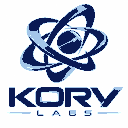
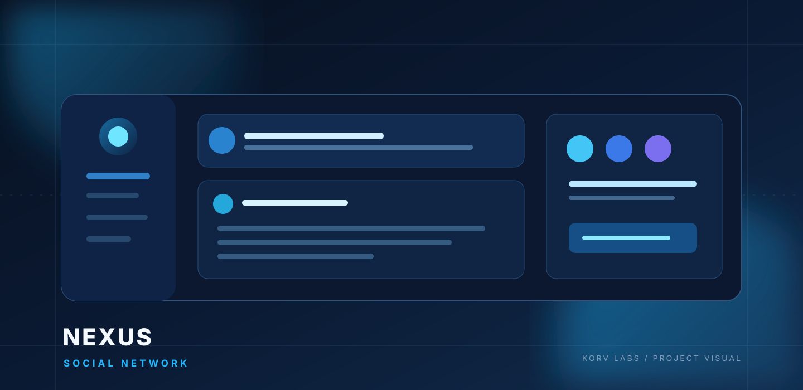
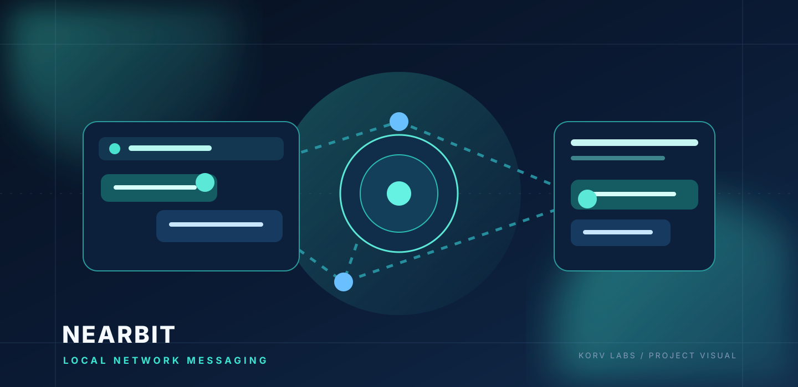
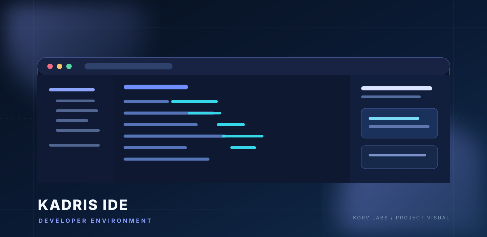
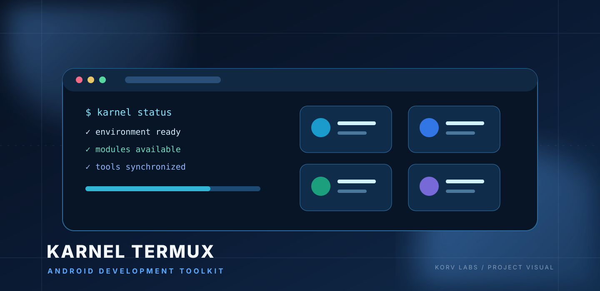
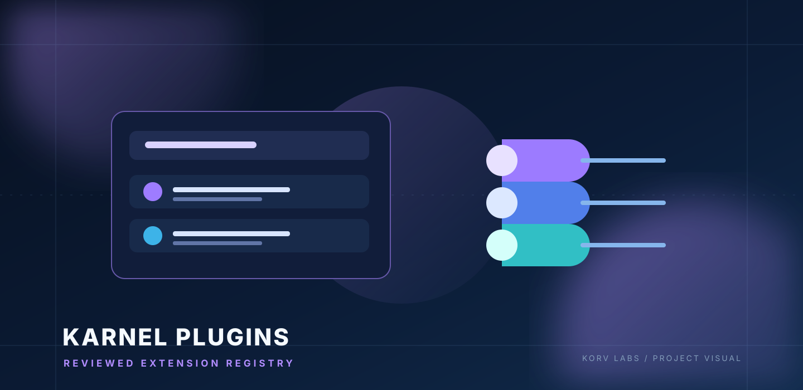
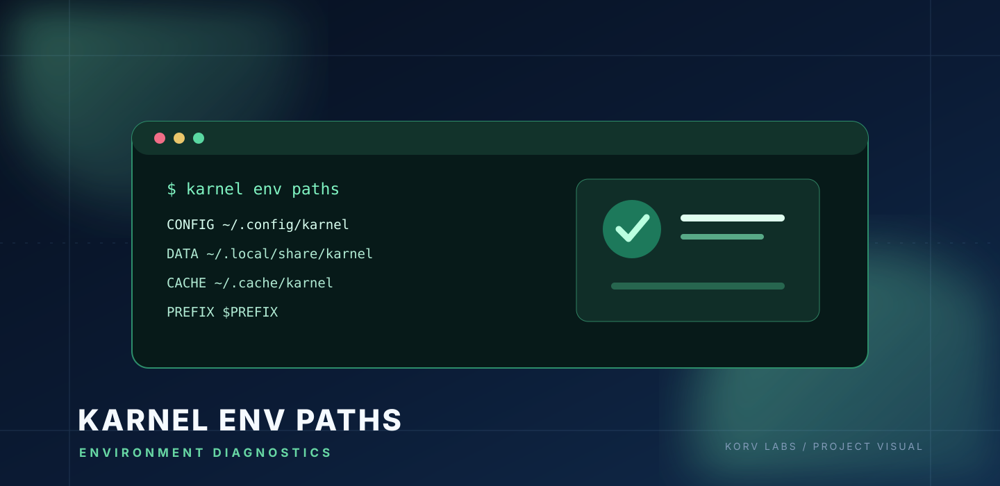
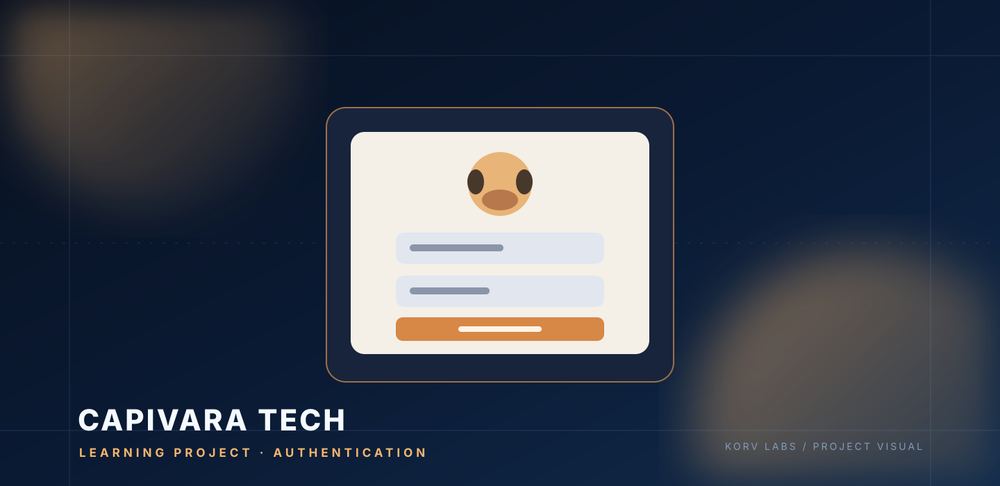
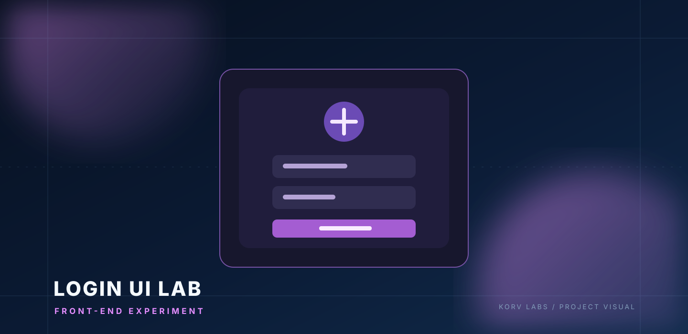

 

 

  
  
  
  
  

---

## ◈ Sobre a KORV Labs

**KORV Labs** é um laboratório independente de tecnologia que reúne projetos de software, plataformas digitais, ferramentas para desenvolvedores e experimentos práticos.

A ideia é transformar conceitos em produtos úteis: projetar, construir, testar, aprender e evoluir continuamente. Cada produto mantém sua própria identidade, enquanto compartilha a visão técnica da KORV Labs.

<table>
  <tr>
    <td width="33%" align="center">
      <h3>01 · BUILD</h3>
      Criar produtos e experiências digitais com propósito.
    </td>
    <td width="33%" align="center">
      <h3>02 · INNOVATE</h3>
      Experimentar novas ideias, arquiteturas e tecnologias.
    </td>
    <td width="33%" align="center">
      <h3>03 · EVOLVE</h3>
      Melhorar continuamente com testes, feedback e engenharia.
    </td>
  </tr>
</table>

## ✦ Projetos em destaque

Os cartões abaixo usam imagens mantidas neste próprio repositório. Assim, as prévias não dependem de serviços de estatísticas de terceiros.

<table>
  <tr>
    <td width="50%" valign="top">
      
      <h3>🌐 Nexus</h3>
      Rede social e comunidade digital da KORV Labs.
       
      
      
    </td>
    <td width="50%" valign="top">
      
      <h3>💬 Nearbit</h3>
      Mensagens em tempo real entre dispositivos na mesma rede local.
       
      
      
    </td>
  </tr>
  <tr>
    <td width="50%" valign="top">
      
      <h3>🧩 Kadris IDE</h3>
      Ambiente de desenvolvimento para desktop e runtime web local.
       
      
      
    </td>
    <td width="50%" valign="top">
      
      <h3>⚙️ Karnel Termux + Docs</h3>
      Ambiente modular para Termux no Android, acompanhado de site e documentação oficial.
       
      
      
    </td>
  </tr>
  <tr>
    <td width="50%" valign="top">
      
      <h3>🔌 Karnel Plugins</h3>
      Registry de extensões revisadas, com manifestos, checksums e validação automatizada.
       
      
    </td>
    <td width="50%" valign="top">
      
      <h3>🧭 Karnel Env Paths</h3>
      Utilitário para consultar versão do Karnel e caminhos de configuração, dados, cache e plugins.
       
      
    </td>
  </tr>
</table>

## ✦ Conheça os projetos

### 🌐 Nexus — Social Network

Uma plataforma social criada para conectar pessoas, comunidades e experiências digitais. O Nexus é um dos principais produtos do ecossistema KORV Labs e mantém sua própria identidade de marca.

- **Produto:** [nexus.devs.li](https://nexus.devs.li/)
- **Foco:** rede social, comunidade e experiências interativas.
- **Código-fonte:** [repositório privado do Nexus](https://github.com/Korv-LabsOFC/nexus).

### 💬 Nearbit — Local Network Messaging

Mensageiro em tempo real projetado para dispositivos conectados à mesma rede local. O projeto explora comunicação direta via HTTP, TCP e WebSockets, com servidor leve e interface responsiva.

- Mensagens em tempo real e lista de usuários conectados.
- Comunicação dentro da rede local, sem depender de um serviço externo de nuvem.
- Base técnica: Node.js, Express, WebSocket, HTML, CSS e JavaScript.
- **Versão:** `0.1.0-alpha`.
- [Código-fonte e documentação](https://github.com/Korv-LabsOFC/nearbit).

### 🧩 Kadris IDE — Developer Environment

Ambiente de desenvolvimento com interface compartilhada para desktop e runtime web local. Reúne recursos de edição, terminal e gerenciamento de projetos em uma única experiência.

- Editor Monaco, explorador de arquivos e terminal local.
- Pré-visualização, controles Git, busca global e restauração de sessão.
- Integração opcional com Codex CLI.
- Base técnica: TypeScript, React, Electron e Node.js.
- **Versão:** `0.1.0-alpha.0`.
- [Código-fonte](https://github.com/Korv-LabsOFC/kadris-ide).

### ⚙️ Karnel Termux — CLI, Website & Documentation

O **Karnel Termux** é um ambiente modular de desenvolvimento para Termux no Android. Ele reúne uma CLI para instalar e gerenciar ferramentas, linguagens, bancos de dados, utilitários, ferramentas de IA, plugins e recursos de desenvolvimento.

O projeto é acompanhado pelo **site oficial e documentação**, que apresentam os comandos, módulos, tutoriais e guias de uso. A CLI e o site fazem parte do mesmo projeto e compartilham esta identidade visual.

| Parte | Acesso |
| --- | --- |
| **Karnel Termux — CLI e código principal** | [Abrir repositório](https://github.com/Korv-LabsOFC/karnel-termux) |
| **Site oficial / documentação** | [karneltermux.vercel.app](https://karneltermux.vercel.app/) |
| **Código-fonte do site e documentação** | [Repositório Karnel Termux Site](https://github.com/Korv-LabsOFC/karnel-termux-site) |

**O que o Karnel reúne:**

| Módulo | O que oferece |
| --- | --- |
| 🤖 IA | Gerenciamento de ferramentas e agentes de IA |
| 💻 Linguagens | Node.js, Python, Go, Rust, C/C++, PHP, Perl e Bun |
| 🗄️ Bancos de dados | PostgreSQL, MariaDB, SQLite, MongoDB e Redis |
| 🧰 Desenvolvimento | GitHub CLI, terminal, editores, automação e utilitários |
| 🔌 Plugins | Descoberta e instalação de extensões do registry |
| 🚀 Deploy | CLIs para plataformas de deploy e serviços |

- **Versão do CLI:** `4.18.8`.
- **Plataforma:** Termux no Android.
- [Abrir o site do Karnel Termux](https://karneltermux.vercel.app/).

### 🔌 Karnel Plugins — Reviewed Plugin Registry

Registry de plugins para o Karnel Termux. Possui manifesto padronizado, validação de schema, verificação de integridade e verificações automatizadas de CI para as entradas aprovadas.

- Catálogo de plugins e comandos.
- Manifestos com versão, licença, compatibilidade e checksum.
- Processo de revisão e validação automatizada.
- [Explorar o registry](https://github.com/Korv-LabsOFC/karnel-plugins).

## 🧪 Outros projetos e experimentos

### 🧭 Karnel Env Paths

Utilitário de diagnóstico que exibe a versão ativa do Karnel e os caminhos XDG de configuração, dados, cache, plugins e prefixo do Termux.

[Ver repositório](https://github.com/Korv-LabsOFC/karnel-env-paths).

### 🦫 Capivara Tech Login

Projeto de aprendizado com Node.js, Express e SQLite, explorando cadastro, autenticação, rotas e persistência de dados. Um dos primeiros experimentos de backend do portfólio.

[Ver repositório](https://github.com/Korv-LabsOFC/projeto-login-capivara-tech).

### 🔐 Login UI Experiment

Experimento front-end com HTML, CSS e JavaScript para estudar telas de login, validação de formulários e feedback visual. Não possui banco de dados.

[Ver repositório](https://github.com/Korv-LabsOFC/Roubador-de-dados-simples-).

## 🛠️ Tecnologias

  

  
  
  
  

## 📊 KORV Labs no GitHub

 

 

## 🐍 Contribuições em movimento

A animação abaixo é gerada automaticamente a partir do histórico de contribuições do GitHub. O workflow deste repositório atualiza os arquivos diariamente e também pode ser executado manualmente em **Actions → Generate contribution snake → Run workflow**.

<picture>
  <source media="(prefers-color-scheme: dark)" srcset="https://raw.githubusercontent.com/Korv-LabsOFC/Korv-LabsOFC/output/github-contribution-grid-snake-dark.svg" />
  <source media="(prefers-color-scheme: light)" srcset="https://raw.githubusercontent.com/Korv-LabsOFC/Korv-LabsOFC/output/github-contribution-grid-snake.svg" />
  
</picture>

## 🤝 Feedback, ideias e colaboração

Cada projeto tem seu próprio repositório e canal de Issues. Para enviar uma sugestão, relatar um problema ou acompanhar uma melhoria, acesse o projeto correspondente:

- [Nearbit — Issues](https://github.com/Korv-LabsOFC/nearbit/issues)
- [Kadris IDE — Issues](https://github.com/Korv-LabsOFC/kadris-ide/issues)
- [Karnel Termux — Issues](https://github.com/Korv-LabsOFC/karnel-termux/issues)
- [Karnel Docs — Issues](https://github.com/Korv-LabsOFC/karnel-termux-site/issues)
- [Karnel Plugins — Issues](https://github.com/Korv-LabsOFC/karnel-plugins/issues)

Para o Nexus, utilize a área de Feedback dentro da própria plataforma.

---

### KORV Labs

**BUILD. INNOVATE. EVOLVE.**

*Independent thinking. Limitless technology.*

