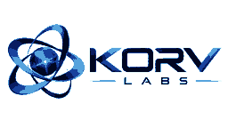

 

  
  
  

---

## ◈ Sobre a KORV Labs

**KORV Labs** é um laboratório independente de tecnologia que reúne projetos de software, plataformas digitais, ferramentas para desenvolvedores e experimentos práticos.

A ideia é transformar conceitos em produtos úteis: projetar, construir, testar, aprender e evoluir continuamente. Cada produto mantém sua própria identidade, enquanto compartilha a visão técnica da KORV Labs.

<table>
  <tr>
    <td width="33%" align="center">
      <h3>01 · BUILD</h3>
      Criar produtos e experiências digitais com propósito.
    </td>
    <td width="33%" align="center">
      <h3>02 · INNOVATE</h3>
      Experimentar novas ideias, arquiteturas e tecnologias.
    </td>
    <td width="33%" align="center">
      <h3>03 · EVOLVE</h3>
      Melhorar continuamente com testes, feedback e engenharia.
    </td>
  </tr>
</table>

## ✦ Projetos em destaque

### 🌐 Nexus — Social Network

Uma plataforma social criada para conectar pessoas, comunidades e experiências digitais. O Nexus é um dos principais produtos do ecossistema KORV Labs e mantém sua própria identidade de marca.

- **Produto:** [nexus.devs.li](https://nexus.devs.li/)
- **Foco:** rede social, comunidade e experiências interativas.
- **Código-fonte:** repositório privado.

### 💬 Nearbit — Local Network Messaging

Mensageiro em tempo real projetado para dispositivos conectados à mesma rede local. O projeto explora comunicação direta via HTTP, TCP e WebSockets, com servidor leve e interface responsiva.

- Mensagens em tempo real e lista de usuários conectados.
- Comunicação dentro da rede local, sem depender de um serviço externo de nuvem.
- Base técnica: Node.js, Express, WebSocket, HTML, CSS e JavaScript.
- [Código-fonte e documentação](https://github.com/Korv-LabsOFC/nearbit).

### 🧩 Kadris IDE — Developer Environment

Ambiente de desenvolvimento com interface compartilhada para desktop e runtime web local. Reúne recursos de edição, terminal e gerenciamento de projetos em uma única experiência.

- Editor Monaco, explorador de arquivos e terminal local.
- Pré-visualização, controles Git, busca global e restauração de sessão.
- Integração opcional com Codex CLI.
- Base técnica: TypeScript, React, Electron e Node.js.
- [Código-fonte](https://github.com/Korv-LabsOFC/kadris-ide).

### ⚙️ Karnel Termux — Modular Development Environment

Uma CLI modular que transforma o Termux em um ambiente de desenvolvimento para Android. O projeto reúne ferramentas de IA, linguagens, bancos de dados, utilitários, editores, ferramentas de rede e opções de deploy.

| Módulo | O que reúne |
| --- | --- |
| 🤖 IA | Gerenciamento de ferramentas e agentes de IA |
| 💻 Linguagens | Node.js, Python, Go, Rust, C/C++, PHP, Perl e Bun |
| 🗄️ Bancos de dados | PostgreSQL, MariaDB, SQLite, MongoDB e Redis |
| 🧰 Desenvolvimento | GitHub CLI, terminal, editores, automação e utilitários |
| 🔌 Plugins | Descoberta e instalação de extensões do registry |
| 🚀 Deploy | CLIs para plataformas de deploy e serviços |

- Desenvolvido especificamente para Termux no Android.
- [Repositório principal](https://github.com/Korv-LabsOFC/karnel-termux).

### 📚 Karnel Termux Docs — Official Documentation

Site oficial de documentação do Karnel Termux, com guias, catálogo de ferramentas e referências dos comandos e módulos da CLI.

- Guias de instalação, diagnóstico e desenvolvimento.
- Conteúdo sobre IA, plugins, banco de dados, deploy, segurança, rede e utilitários.
- Interface responsiva para desktop e dispositivos móveis.
- [Repositório da documentação](https://github.com/Korv-LabsOFC/karnel-termux-site).

### 🔌 Karnel Plugins — Reviewed Plugin Registry

Registry de plugins para o Karnel Termux. Possui manifesto padronizado, validação de schema, verificação de integridade e verificações automatizadas de CI para as entradas aprovadas.

- Catálogo de plugins e comandos.
- Manifestos com versão, licença, compatibilidade e checksum.
- Processo de revisão e validação automatizada.
- [Explorar o registry](https://github.com/Korv-LabsOFC/karnel-plugins).

---

## 🧪 Outros projetos e experimentos

| Projeto | Descrição |
| --- | --- |
| [Karnel Env Paths](https://github.com/Korv-LabsOFC/karnel-env-paths) | Utilitário de diagnóstico que mostra versão do Karnel e caminhos XDG de configuração, dados, cache, plugins e prefixo Termux. |
| [Capivara Tech Login](https://github.com/Korv-LabsOFC/projeto-login-capivara-tech) | Projeto de aprendizado com Node.js, Express e SQLite, explorando cadastro, autenticação e persistência. |
| [Login UI Experiment](https://github.com/Korv-LabsOFC/Roubador-de-dados-simples-) | Experimento de front-end com HTML, CSS e JavaScript para estudar telas de login e validação; não possui banco de dados. |

Esses projetos também fazem parte da trajetória de desenvolvimento da KORV Labs: desde protótipos e estudos até ferramentas e produtos mais completos.

## 🛠️ Tecnologias

  

  
  
  
  

## 📊 KORV Labs no GitHub

 

 

## 🐍 Contribuições em movimento

A animação abaixo é gerada automaticamente a partir do histórico de contribuições do GitHub. O workflow deste repositório atualiza os arquivos diariamente e também pode ser executado manualmente em **Actions → Generate contribution snake → Run workflow**.

<picture>
  <source media="(prefers-color-scheme: dark)" srcset="https://raw.githubusercontent.com/Korv-LabsOFC/Korv-LabsOFC/output/github-contribution-grid-snake-dark.svg" />
  <source media="(prefers-color-scheme: light)" srcset="https://raw.githubusercontent.com/Korv-LabsOFC/Korv-LabsOFC/output/github-contribution-grid-snake.svg" />
  
</picture>

## 🤝 Feedback, ideias e colaboração

Cada projeto tem seu próprio repositório e canal de Issues. Para enviar uma sugestão, relatar um problema ou acompanhar uma melhoria, acesse o projeto correspondente:

- [Nearbit — Issues](https://github.com/Korv-LabsOFC/nearbit/issues)
- [Kadris IDE — Issues](https://github.com/Korv-LabsOFC/kadris-ide/issues)
- [Karnel Termux — Issues](https://github.com/Korv-LabsOFC/karnel-termux/issues)
- [Karnel Docs — Issues](https://github.com/Korv-LabsOFC/karnel-termux-site/issues)
- [Karnel Plugins — Issues](https://github.com/Korv-LabsOFC/karnel-plugins/issues)

Para o Nexus, utilize a área de Feedback dentro da própria plataforma.

---

### KORV Labs

**BUILD. INNOVATE. EVOLVE.**

*Independent thinking. Limitless technology.*

